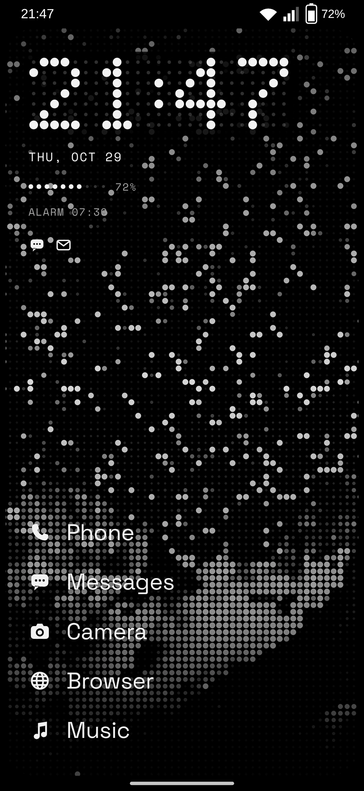
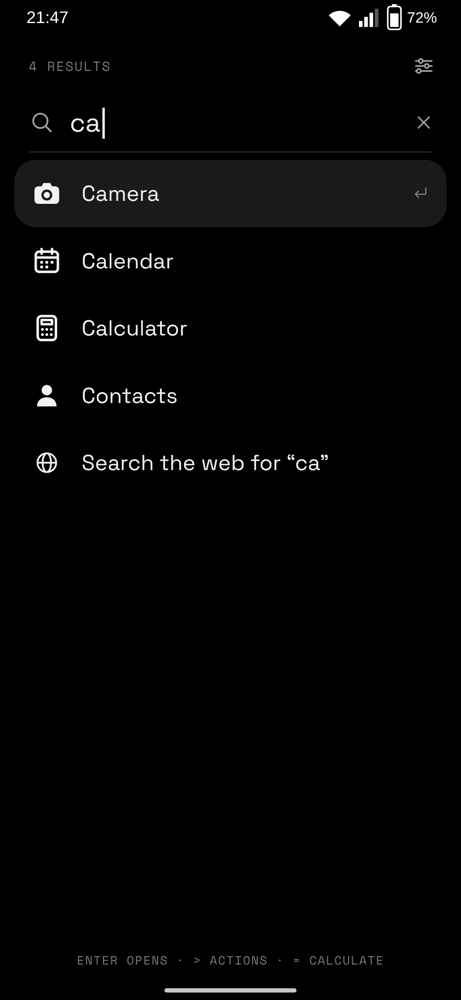
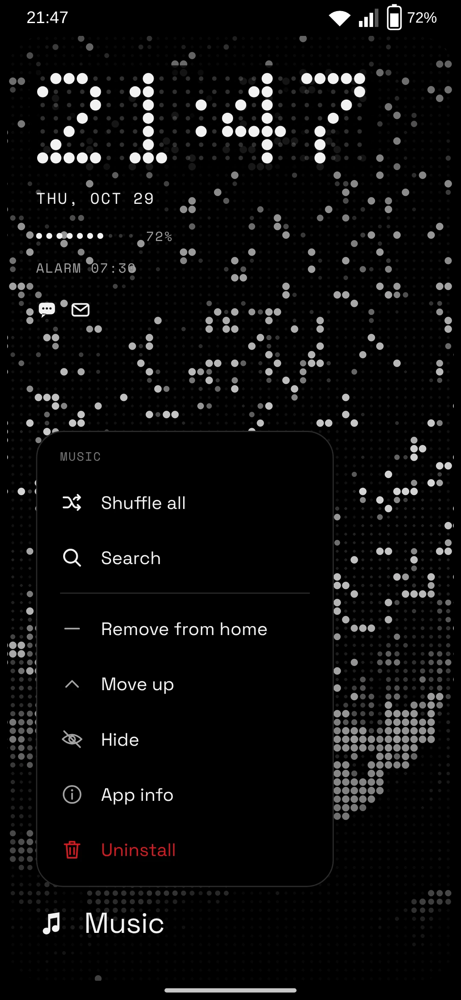
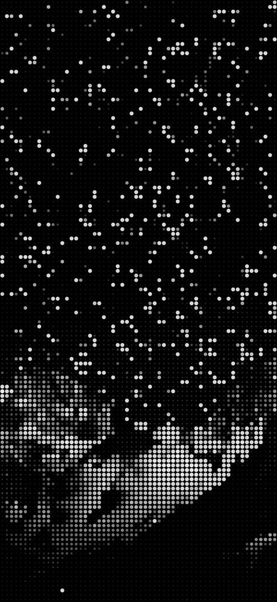

<p align="center">
  <picture>
    <source media="(prefers-color-scheme: dark)" srcset="docs/brand/nihil-logo-dark.svg">
    
  </picture>
</p>

<p align="center"><b>ex nihilo</b> &nbsp;·&nbsp; a monochrome, dot-matrix launcher for Android</p>

<p align="center">
  <a href="https://github.com/poligle/Nihil-Launcher/releases/latest">Download</a> &nbsp;·&nbsp;
  <a href="https://nihilshell.com/android/">Website</a> &nbsp;·&nbsp;
  <a href="#install">Install</a> &nbsp;·&nbsp;
  <a href="#permissions">Permissions</a> &nbsp;·&nbsp;
  <a href="https://github.com/poligle/Nihil-Shell">Desktop for NixOS</a>
</p>

<p align="center">
  &nbsp;
  &nbsp;
  
</p>

NIHIL for Android is my home screen. It speaks the language of
[NIHIL](https://github.com/poligle/Nihil-Shell), my NixOS desktop: black, greys for
hierarchy, dots for display, red only to interrupt, and light that runs along the edge.
I wrote it because every launcher worth using either costs money or is full of ads.

No ads, no tracking, no account, and **no internet permission**: it couldn't send
anything anywhere even if it wanted to. It is about 4,500 lines of Kotlin on the Android
framework alone — no AndroidX, no Compose, no libraries beyond the Kotlin standard library.

> Made for and tested on a Galaxy A35 with One UI. Any phone with Android 12 or newer
> should work, but that is the only one it has run on so far.

---

## Highlights

- **The frame.** The screen is black and the wallpaper is a rounded card set into it, the
  same frame as the desktop. The status bar and the gesture bar sit on the frame, and the
  card follows the screen's own rounded corners.
- **The drawer is the frame growing.** Swipe up and the card's bottom edge follows your
  finger until the whole screen is frame. The content switches on at the end, like LEDs.
- **An LED clock.** A 25 × 7 panel where every LED is there, the unlit ones faintly, on a
  dark module. When the minute changes it refreshes column by column.
- **The battery as ten LEDs.** Red at 15 % when it isn't charging, the only alarm colour;
  while charging, the next LED breathes. The next alarm sits underneath.
- **Light on the frame.** With notification access, a run of LEDs goes round the frame for
  every notification: twice and in red for a call or an alarm, up from the bottom when
  the charger goes in. Apps with unread notifications show under the clock.
- **One field.** Apps, actions and sums in a single search, accents and case ignored;
  `>` for actions, `=` for the calculator, enter runs the first result.
- **Wallpaper studio.** A photo becomes an LED matrix at the exact resolution of the
  screen, with the desktop's algorithm.
- **Icons in one voice.** Themed icons in ink; apps without one get their foreground layer
  in greys. Or grey, or the original colours.
- **Spanish or English**, following the phone's language.

<sub>The screens at the top are renders of the launcher's own layout (`ui/`) at a Galaxy
A35's resolution, with generic app icons in ink and a wallpaper made with the studio's algorithm.</sub>

---

## Design language

The same three rules as the desktop:

1. **Hierarchy is made with greys.** Red only interrupts: low battery, a call, an alarm,
   "Uninstall".
2. **Dots are for display.** The clock and the battery are LEDs, Doto sets the big
   numbers; text is Space Grotesk and metadata uppercase Space Mono.
3. **The frame is hardware.** Opaque, flat, no shadows. The drawer is part of it, not a
   sheet on top.

The tokens are the desktop's ([`theme/nihil.nix`](https://github.com/poligle/Nihil-Shell/blob/nihil/theme/nihil.nix)),
mirrored in [`ui/Nihil.kt`](app/src/main/java/com/nihilshell/launcher/ui/Nihil.kt):

| Token     | Hex       | Use                               |
|-----------|-----------|-----------------------------------|
| `void`    | `#000000` | Frame, drawer, menus              |
| `raised`  | `#1A1A1A` | The selected result, the sums     |
| `line`    | `#2A2A2A` | 1 px lines, outlines              |
| `muted`   | `#7A7A7A` | Metadata, hints                   |
| `dim`     | `#A3A3A3` | Secondary text, icons             |
| `ink`     | `#F2F2F2` | Text, lit LEDs                    |
| `signal`  | `#D71921` | Interrupts only                   |

Motion uses one curve, `cubic-bezier(0.2, 0, 0, 1)`, at 140, 240, 320 or 480 ms.

---

## Install

1. Download `nihil-launcher-v….apk` from the
   [latest release](https://github.com/poligle/Nihil-Launcher/releases/latest). The
   `.sha256` next to it checks the download: `sha256sum -c nihil-launcher-v….apk.sha256`.
2. Open it on the phone and let your browser or file manager install apps when Android
   asks.
3. Open **NIHIL** from the app list and tap **Home app**, or Settings → Apps → Default
   apps → Home app.

The light on the frame needs notification access, and the double tap the accessibility
service; NIHIL's settings take you to both. Installed from an APK file, Android 13 and
later may grey them out as a *restricted setting*: App info → ⋮ → **Allow restricted
settings**.

To build it yourself, see [Build](#build).

---

## Gestures

| On the home screen | Does                                                       |
|--------------------|------------------------------------------------------------|
| Swipe up           | The drawer, following your finger                          |
| Swipe down         | The notification shade                                     |
| Double tap         | Locks the phone (optional)                                 |
| Hold empty space   | NIHIL wallpaper, system wallpaper, NIHIL settings          |
| Hold an app        | Its shortcuts · add to home, move, hide · app info · uninstall |
| Home button        | Closes the drawer or a menu                                |

In the drawer, a downward drag closes it when the list is at the top; back does the same.

---

## The drawer

| Type           | Gets                                                                 |
|----------------|----------------------------------------------------------------------|
| *(empty)*      | Every app, alphabetically, under dot-matrix letters                  |
| `camara`       | *Cámara*: accents and case don't matter                              |
| `settings`     | *Ajustes*, through its package name (`com.android.settings`)         |
| `lin`          | Apps and actions together: here, the torch                           |
| `12*7`         | A sum is recognised on its own; enter copies the result              |
| `> `           | The actions: torch, Wi-Fi and sound panels, Bluetooth, battery, alarms, lock, studio, settings |
| `= `           | The calculator: `+ − × ÷ ^ % !`, `sqrt cbrt abs ln log log2 exp sin cos tan asin acos atan round floor`, `pi`, `e`, `2pi`, `3(4+1)`, comma or point |
| no match       | *Search the web for…*, in your own browser                           |

Hidden apps leave the list but search still finds them, marked *hidden*.

---

## Wallpaper studio



Hold the home screen → **NIHIL wallpaper**, or type `> wallpaper`.

Pick a photo and it becomes an LED matrix at the exact resolution of the screen, with the
same algorithm and constants as the desktop's
[`theme/dotmatrix.py`](https://github.com/poligle/Nihil-Shell/blob/nihil/theme/dotmatrix.py):
the light of each cell, the black point raised so a night sky stays off, single
highlights lit as stars, and LEDs that grow with their brightness.

Fine, normal or coarse dots; the home screen, the lock screen or both. It all happens on
the phone: the photo goes nowhere.

<sub>Right: the desktop's <code>night.jpg</code> through the studio's algorithm, normal dots.</sub>

<br clear="right">

---

## Settings

Open **NIHIL** from the app list, the gear in the drawer, or hold the home screen.

| Setting                         | Default | What it does                                                      |
|---------------------------------|---------|-------------------------------------------------------------------|
| Home app                        |         | Makes NIHIL the home screen                                       |
| Icons                           | mono    | `mono` themed icons in ink, `grey`, or `colour`                   |
| Icons in favourites             | on      | Icons next to the favourites, or names alone                      |
| Dim the wallpaper               | off     | A dark veil over any wallpaper                                    |
| NIHIL wallpaper                 |         | The studio                                                        |
| Keyboard when the drawer opens  | on      | Type straight away, or browse first                               |
| Glyph light                     | on      | The light on the frame and the unread icons (needs notification access) |
| Double tap to lock              | off     | Needs the accessibility service, which only locks                 |
| Hidden apps                     |         | Show them in the list again                                       |

---

## Permissions

| Permission                     | What for                                                          |
|--------------------------------|-------------------------------------------------------------------|
| `SET_WALLPAPER`                | The studio                                                        |
| `EXPAND_STATUS_BAR`            | Swipe down for the notifications                                  |
| `REQUEST_DELETE_PACKAGES`      | "Uninstall" in the app menu                                       |
| Notification access, optional  | The light on the frame and the unread icons                       |
| Accessibility, optional        | Only to lock the phone on a double tap                            |

There is no `INTERNET` permission. Of a notification, NIHIL looks at which app posted it,
its flags and its category, never its text; silent notifications and anything Do Not
Disturb holds back stay dark. The accessibility service reads no content and only
listens to NIHIL's own windows.

---

## Build

JDK 17 and the Android SDK: platform 35, build-tools 35.0.0.

```sh
git clone https://github.com/poligle/Nihil-Launcher nihil-launcher
cd nihil-launcher
```

**Android Studio** — open the folder and press Run.

**Nix** — the flake has a dev shell with the JDK, the SDK and `adb`:

```sh
nix develop
./gradlew installDebug      # the phone on USB or wireless debugging
./gradlew test              # the pure Kotlin core on the JVM
```

On recent NixOS (systemd 258) USB access works out of the box; on older releases, use
`programs.adb.enable`. Wireless debugging works everywhere: Developer options →
Wireless debugging → *Pair device with pairing code*, then `adb pair IP:PORT` and
`adb connect IP:PORT` with the port of the main screen.

`./gradlew assembleRelease` builds a minified APK, signed with the debug key unless you
pass your own. Every push runs the tests and a build on CI; a tag publishes a signed
release ([RELEASING.md](RELEASING.md)).

---

## Structure

```
app/src/main/java/com/nihilshell/launcher/
├── LauncherActivity.kt    the home screen: layers, insets, gestures, receivers
├── SettingsActivity.kt    settings, also "NIHIL" in the app list
├── WallpaperActivity.kt   the studio
├── core/
│   ├── Apps.kt            every launchable app, in every profile; icons off the main thread
│   ├── IconRenderer.kt    mono, grey and colour icons
│   ├── Search.kt          what the drawer shows for a query
│   ├── Fuzzy.kt           scoring: exact, prefix, word, inside, letters in order
│   ├── Calculator.kt      a small recursive-descent calculator
│   ├── Actions.kt         the "> actions"
│   ├── LedFont.kt         the clock's 5 × 7 digits
│   ├── DotMatrix.kt       a photo as LEDs (pure Kotlin)
│   ├── DotRender.kt       decoding and drawing for the studio
│   ├── Prefs.kt           everything NIHIL remembers
│   └── Torch.kt
├── ui/
│   ├── FrameView.kt       the frame and the Glyph light
│   ├── HomeView.kt        clock, battery, alarm, unread, favourites
│   ├── DrawerView.kt      the field and the results
│   ├── RootLayout.kt      swipes, double tap, long press
│   ├── LedClock.kt · LedGauge.kt · LineIcon.kt · AppMenu.kt · Widgets.kt
│   └── Nihil.kt           tokens, fonts, motion
└── system/
    ├── GlyphListener.kt   notification access (optional)
    ├── LockService.kt     accessibility, to lock (optional)
    ├── Glyph.kt           the bus between the two
    └── Access.kt          home role, accesses, the shade
```

---

## Technical details

- **No libraries.** Views are built in code on the framework: `ListView`, `PopupWindow`,
  `LauncherApps`, `RoleManager`, `WindowInsets`. The only dependencies are the Kotlin
  standard library and, for the tests, JUnit.
- **The frame** is one even-odd path: the screen minus a rounded card whose corner comes
  from the display's own `RoundedCorner`. Opening the drawer only moves the card's bottom
  edge, so each frame of the animation is a single path redraw.
- **Nothing runs in the background.** The clock follows `TIME_TICK` and the battery its
  broadcast, only while the home screen is visible. The notification listener and the
  accessibility service exist only if you turn them on.
- **Icons**: Android 13's monochrome layer tinted ink. Without one, the foreground layer is
  clipped to the icon's circle, turned to greys and inverted when it's mostly dark; a
  foreground that fills the icon falls back to grey. Rendered on two threads, cached.
- **Search** strips accents (NFD), scores exact, prefix, start of a word, inside and
  letters in order, and gives actions a small handicap so apps win ties.
- **Swipe down** uses `StatusBarManager.expandNotificationsPanel` through reflection, as
  many launchers do; if Android ever blocks it, the accessibility service opens the shade.
- **Tests** cover the pure core on the JVM: search, calculator, LED font, dot matrix and
  icon statistics.

---

## Credits

- [NIHIL for NixOS](https://github.com/poligle/Nihil-Shell), where the language comes from,
  and [Caelestia](https://github.com/caelestia-dots/shell) for the frame-and-drawers idea.
- [Nothing](https://nothing.tech) for the design language that inspired the look. NIHIL is a
  personal project and is not affiliated with Nothing Technology.
- Fonts: [Doto](https://github.com/oliverlalan/Doto),
  [Space Grotesk](https://github.com/floriankarsten/space-grotesk) and Space Mono, under the
  SIL Open Font License 1.1 ([`OFL.txt`](app/src/main/assets/fonts/OFL.txt)).

## Licence

MIT ([`LICENSE`](LICENSE)). Changes are in [CHANGELOG.md](CHANGELOG.md).
