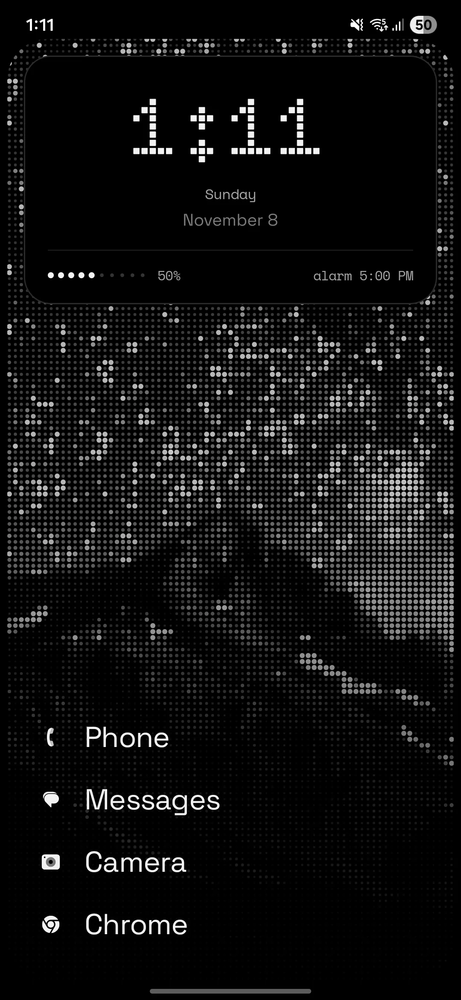
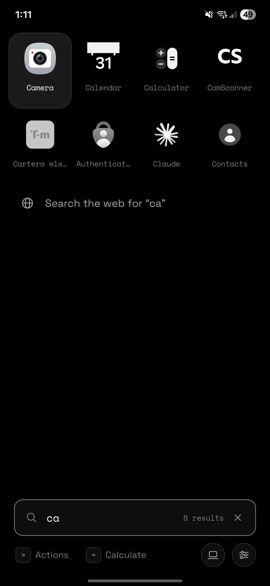
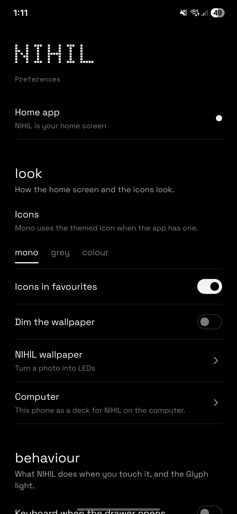
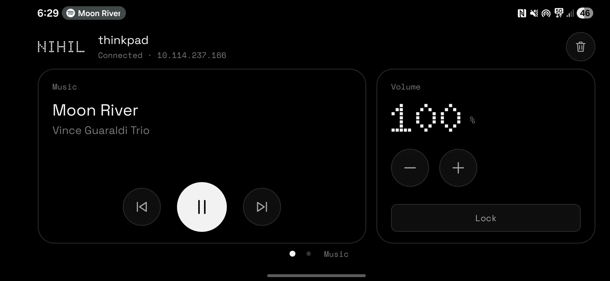
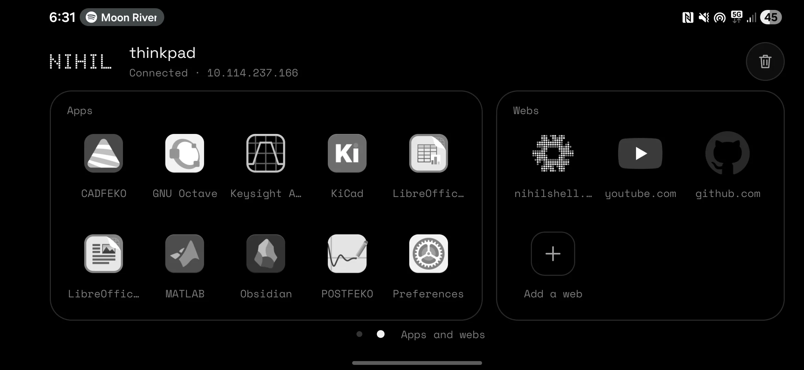
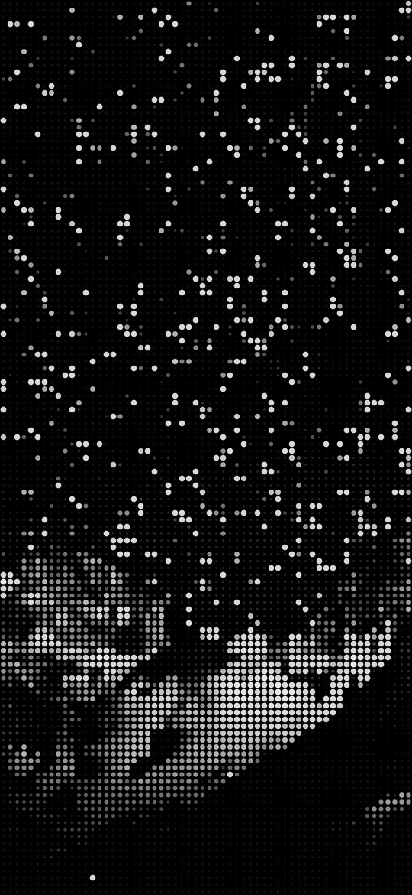

<p align="center">
  <picture>
    <source media="(prefers-color-scheme: dark)" srcset="docs/brand/nihil-logo-dark.svg">
    
  </picture>
</p>

<p align="center"><i>ex nihilo</i></p>

<p align="center">A monochrome, dot-matrix launcher for Android</p>

<p align="center">
  <a href="https://github.com/poligle/Nihil-Launcher/releases/latest">Download</a> &nbsp;&nbsp;&nbsp;
  <a href="https://nihilshell.com/android/">Website</a> &nbsp;&nbsp;&nbsp;
  <a href="#install">Install</a> &nbsp;&nbsp;&nbsp;
  <a href="#permissions">Permissions</a> &nbsp;&nbsp;&nbsp;
  <a href="https://github.com/poligle/Nihil-Shell">Desktop for NixOS</a>
</p>

<p align="center">
  &nbsp;
  &nbsp;
  
</p>

NIHIL for Android is my home screen. It speaks the language of
[NIHIL](https://github.com/poligle/Nihil-Shell), my NixOS desktop: black, greys for
hierarchy, dots for display, red only to interrupt, and light that runs along the edge.
I wrote it because every launcher worth using either costs money or is full of ads.

No ads, no tracking, no account. It talks to nothing but **your own computer**, and only
if you pair it as a deck: that is all its `INTERNET` permission is for. It is about 7,000
lines of Kotlin on the Android framework alone — no AndroidX, no Compose, no libraries
beyond the Kotlin standard library; even the QR reader is its own.

> Made for and tested on a Galaxy A35 with One UI. Any phone with Android 12 or newer
> should work, but that is the only one it has run on so far.

---

## Highlights

- **The frame.** The screen is black and the wallpaper is a rounded card set into it, the
  same frame as the desktop. The status bar and the gesture bar sit on the frame, and the
  card follows the screen's own rounded corners.
- **The drawer is the frame growing, and the desktop's launcher.** Swipe up and the card's
  bottom edge follows your finger until the whole screen is frame. The apps in a monochrome
  grid, the first result raised and in colour, the field at the bottom by your thumb.
- **The desktop's clock.** A black card with the time in dots, the day and the date; under a
  hairline, the battery as ten LEDs (red at 15 % when it isn't charging), the next alarm and
  the apps with unread notifications.
- **The Glyph light.** With notification access, the desktop's light runs once round the
  frame for every notification, twice and in red for a call or an alarm, and climbs from the
  bottom when the charger goes in. With the accessibility service, round the screen's own
  corners over any app.
- **The deck.** Paired with NIHIL on your computer, the phone opens its apps and webs, plays
  its music, turns its volume and locks it. [More below](#the-deck).
- **One field.** Apps, actions and sums in a single search, accents and case ignored;
  `>` for actions, `=` for a calculator near the desktop's qalc: units, bases, percentages,
  derivatives, integrals and equations.
- **Wallpaper studio.** A photo becomes an LED matrix at the exact resolution of the
  screen, with the desktop's algorithm; a fresh install starts with NIHIL's night.
- **Icons in one voice.** Themed icons in ink; apps without one get their foreground layer
  in greys. Or grey, or the original colours. NIHIL's own is the Android robot in dots, as
  the desktop wears the NixOS snowflake.
- **Spanish or English**, the phone's language or its own (Android 13 and later).

<sub>Screenshots from a Galaxy A35.</sub>

---

## Design language

The same three rules as the desktop:

1. **Hierarchy is made with greys.** Red only interrupts: low battery, a call, an alarm,
   "Uninstall".
2. **Dots are for display.** The clock and the battery are LEDs, Doto sets the big
   numbers; text is Space Grotesk and metadata uppercase Space Mono.
3. **The frame is hardware.** Opaque, flat, no shadows. The drawer is part of it, not a
   sheet on top.

The tokens are the desktop's ([`theme/nihil.nix`](https://github.com/poligle/Nihil-Shell/blob/nihil/theme/nihil.nix)),
mirrored in [`ui/Nihil.kt`](app/src/main/java/com/nihilshell/launcher/ui/Nihil.kt):

| Token     | Hex       | Use                               |
|-----------|-----------|-----------------------------------|
| `void`    | `#000000` | Frame, drawer, menus              |
| `raised`  | `#1A1A1A` | The selected result, the sums     |
| `line`    | `#2A2A2A` | 1 px lines, outlines              |
| `muted`   | `#7A7A7A` | Metadata, hints                   |
| `dim`     | `#A3A3A3` | Secondary text, icons             |
| `ink`     | `#F2F2F2` | Text, lit LEDs                    |
| `signal`  | `#D71921` | Interrupts only                   |

Motion uses one curve, `cubic-bezier(0.2, 0, 0, 1)`, at 140, 240, 320 or 480 ms.

---

## Install

1. Download `nihil-launcher-v….apk` from the
   [latest release](https://github.com/poligle/Nihil-Launcher/releases/latest). The
   `.sha256` next to it checks the download: `sha256sum -c nihil-launcher-v….apk.sha256`.
2. Open it on the phone and let your browser or file manager install apps when Android
   asks.
3. Open **NIHIL** from the app list and tap **Home app**, or Settings → Apps → Default
   apps → Home app.

The light on the frame needs notification access; the double tap, and the same light over
other apps, the accessibility service. NIHIL's settings take you to both. The first time
NIHIL is the home app it puts on its own wallpaper, the night in LEDs, as the desktop
starts; the studio changes it. Installed from an APK file, Android 13 and
later may grey them out as a *restricted setting*: App info → ⋮ → **Allow restricted
settings**.

To build it yourself, see [Build](#build).

---

## Gestures

| On the home screen | Does                                                       |
|--------------------|------------------------------------------------------------|
| Swipe up           | The drawer, following your finger                          |
| Swipe down         | The notification shade                                     |
| Double tap         | Locks the phone (optional)                                 |
| Hold empty space   | NIHIL wallpaper, NIHIL settings                            |
| Hold an app        | Its shortcuts, add to home, move, hide, app info, uninstall; on the home screen, move it to put the favourites in order |
| Home button        | Closes the drawer or a menu                                |

In the drawer, a downward drag closes it when the list is at the top; back does the same.

---

## The drawer

| Type           | Gets                                                                 |
|----------------|----------------------------------------------------------------------|
| *(empty)*      | Every app, alphabetically, in a grid                                 |
| `camara`       | *Cámara*: accents and case don't matter                              |
| `settings`     | *Ajustes*, through its package name (`com.android.settings`)         |
| `lin`          | Apps and actions together: here, the torch                           |
| `12*7`         | A sum is recognised on its own; enter copies the result              |
| `10 km to mi`  | So is a conversion, of units or into hex, bin and oct                |
| `> `           | The actions: torch, Wi-Fi and sound panels, Bluetooth, battery, alarms, lock, studio, settings |
| `= `           | The calculator, [below](#the-calculator)                             |
| No match       | *Search the web for…*, in your own browser                           |

Hidden apps leave the list but search still finds them, marked *hidden*.

### The calculator

As near the desktop's (qalc) as one Kotlin file gets, comma or point for decimals:

| Type                         | Gets                                                   |
|------------------------------|--------------------------------------------------------|
| `2(3+4)^2`, `5!`, `2pi`      | The usual, with implicit products                      |
| `200 + 15%`, `200 * 15%`     | 230 and 30: percentages as qalc reads them; `mod` for the remainder |
| `sin(30°)`, `atan(1)`        | Degrees with `°`, radians otherwise                    |
| `max(3; 4)`, `gcd(12; 18)`   | Several arguments, apart with `;` or `, `              |
| `10 km to mi`, `100 °F a °C` | Length, mass, time, temperature, data, speed, volume, area, energy, pressure, power, angle |
| `0xff`, `255 to hex`         | Hex, binary and octal, both ways                       |
| `diff(x^2)`, `diff(x^3; 2)`  | 2x, and its value at 2: 12                             |
| `integrate(x^2)`, `integrate(x^2; 0; 3)` | x^3/3 + C, and 9; bounds may be `inf`      |
| `solve(x^2 = 4)`             | x = -2, x = 2 (real solutions)                        |
| `sum(i^2; i; 1; 10)`, `limit(sin(x)/x; x; 0)` | 385 and 1; `product` too          |

Spanish names work too: `deriva`, `integra`, `resuelve`, `suma`, `producto`, `límite`. No
currencies: they would need the internet.

---

## The deck

The phone as a remote for [NIHIL](https://github.com/poligle/Nihil-Shell) on your computer:
it opens the computer's apps and webs, plays, pauses and skips its music, turns its volume and
locks it. It can't run commands or read files.

1. On the computer: Preferences → Phone → **Use the phone**, apply, then **Pair a phone**.
2. On the phone: the laptop key under the drawer's field, `> computer`, or Settings →
   Computer → **Pair**, and point the camera at the QR.

<p align="center">
  &nbsp;
  
</p>

The deck is landscape, on one screen, in workspaces as the desktop's: the music with its
cover, in greys, and the volume in one; the apps and the webs, each scrolling on its own, in
the other. Swipe between them or tap their dots. Hold an app or a web and move it to put
them in order. At the top, the computer's caffeine, night light and lock, with the desktop's
own icons and lit while on. **Screen on in the deck**, in Settings, keeps this phone's screen
on while it is open. The apps come with the computer's icons; the webs are kept on the phone
(add one, or share it from the browser), with icons the computer finds for them.
**Open on the computer** in the share sheet opens a web there.

- **Only your computer.** HTTPS that trusts one certificate, the one whose key is pinned in
  the QR, checked before anything is sent. When the computer's address changes, the phone
  finds it again with mDNS; the pin still decides.
- **Its own QR reader.** The camera's frames go to `core/QrDecoder.kt` and nowhere else.
- **A token per phone**, encrypted with a key that never leaves the Android Keystore, out of
  backups. Forget the phone in Preferences and it forgets the computer too.

The protocol is [docs/deck.md](https://github.com/poligle/Nihil-Shell/blob/nihil/docs/deck.md)
in Nihil-Shell.

### Tasks

The desktop's kanban, on the phone: the key beside the computer's under the drawer's field,
or `> tasks`. To do, doing and done, the same cards. Every change stays on the phone at once
and goes to the computer when it answers; apart for a while, each side goes on, and the next
sync keeps what both did: for each card, the text written last and the column chosen last, and
a deletion over anything older (`core/TaskBoard.kt`, as `Tasks.qml` and `TaskMerge.js` on the
desktop).

---

## Wallpaper studio



Hold the home screen → **NIHIL wallpaper**, or type `> wallpaper`.

Pick a photo and it becomes an LED matrix at the exact resolution of the screen, with the
same algorithm and constants as the desktop's
[`theme/dotmatrix.py`](https://github.com/poligle/Nihil-Shell/blob/nihil/theme/dotmatrix.py):
the light of each cell, the black point raised so a night sky stays off, single
highlights lit as stars, and LEDs that grow with their brightness.

Fine, normal or coarse dots; the home screen, the lock screen or both. It all happens on
the phone: the photo goes nowhere.

<sub>Right: the desktop's <code>night.jpg</code> through the studio's algorithm, normal dots.</sub>

<br clear="right">

---

## Settings

Open **NIHIL** from the app list, the gear in the drawer, or hold the home screen.

| Setting                         | Default | What it does                                                      |
|---------------------------------|---------|-------------------------------------------------------------------|
| Home app                        |         | Makes NIHIL the home screen                                       |
| Icons                           | Mono    | `mono` themed icons in ink, `grey`, or `colour`                   |
| Icons in favourites             | On      | Icons next to the favourites, or names alone                      |
| Dim the wallpaper               | Off     | A dark veil over any wallpaper                                    |
| NIHIL wallpaper                 |         | The studio                                                        |
| Keyboard when the drawer opens  | On      | Type straight away, or browse first                               |
| Language                        |         | Android 13 and later: English or Spanish, whatever the phone speaks |
| Computer                        |         | The deck: pair with NIHIL on your computer                        |
| Screen on in the deck           | Off     | This phone's screen doesn't turn off while the deck is open       |
| Glyph light                     | On      | The light on the frame and the unread icons (needs notification access); over other apps too with the accessibility service |
| Double tap to lock              | Off     | Needs the accessibility service, which locks and draws the light  |
| Hidden apps                     |         | Show them in the list again                                       |

---

## Permissions

| Permission                     | What for                                                          |
|--------------------------------|-------------------------------------------------------------------|
| `SET_WALLPAPER`                | The studio, and NIHIL's wallpaper the first time it is home       |
| `EXPAND_STATUS_BAR`            | Swipe down for the notifications                                  |
| `REQUEST_DELETE_PACKAGES`      | "Uninstall" in the app menu                                       |
| `INTERNET`                     | The deck, only ever to the computer it was paired with            |
| `CAMERA`                       | The deck, to read the computer's pairing QR                       |
| Notification access, optional  | The light on the frame and the unread icons                       |
| Accessibility, optional        | To lock the phone on a double tap, and the Glyph light over other apps |

`INTERNET` reaches only the paired computer, over HTTPS pinned to its key; the webs'
icons come through it too. The camera's frames never leave the phone: NIHIL reads the QR
itself. Of a notification, NIHIL looks at which app posted it,
its flags and its category, never its text; silent notifications and anything Do Not
Disturb holds back stay dark. The accessibility service reads no content and only
listens to NIHIL's own windows; the light it draws is a window of its own that takes no
touch, and is there only while the light runs.

---

## Build

JDK 17 and the Android SDK: platform 35, build-tools 35.0.0.

```sh
git clone https://github.com/poligle/Nihil-Launcher nihil-launcher
cd nihil-launcher
```

**Android Studio** — open the folder and press Run.

**Nix** — the flake has a dev shell with the JDK, the SDK and `adb`:

```sh
nix develop
./gradlew installDebug      # the phone on USB or wireless debugging
./gradlew test              # the pure Kotlin core on the JVM
```

On recent NixOS (systemd 258) USB access works out of the box; on older releases, use
`programs.adb.enable`. Wireless debugging works everywhere: Developer options →
Wireless debugging → *Pair device with pairing code*, then `adb pair IP:PORT` and
`adb connect IP:PORT` with the port of the main screen.

`./gradlew assembleRelease` builds a minified APK, signed with the debug key unless you
pass your own. Every push runs the tests and a build on CI; a tag publishes a signed
release ([RELEASING.md](RELEASING.md)).

---

## Structure

```
app/src/main/java/com/nihilshell/launcher/
├── LauncherActivity.kt    the home screen: layers, insets, gestures, receivers
├── SettingsActivity.kt    settings, also "NIHIL" in the app list
├── WallpaperActivity.kt   the studio
├── DeckActivity.kt        the deck: music, volume, caffeine, night light, lock, apps and webs
├── DeckScanActivity.kt    pairing: the camera and the QR
├── DeckShareActivity.kt   "Open on the computer" in the share sheet
├── TasksActivity.kt       the desktop's kanban
├── deck/
│   ├── DeckClient.kt      HTTPS pinned to the computer, pairing, mDNS
│   ├── DeckStore.kt       the computer, its token in the Keystore, the webs
│   └── TasksStore.kt      the kanban on the phone, its clock and its sync
├── core/
│   ├── Apps.kt            every launchable app, in every profile; icons off the main thread
│   ├── IconRenderer.kt    mono, grey and colour icons
│   ├── Search.kt          what the drawer shows for a query
│   ├── Fuzzy.kt           scoring: exact, prefix, word, inside, letters in order
│   ├── Calculator.kt      the calculator: sums, percentages, units, bases
│   ├── Symbolic.kt        its calculus: derivatives, integrals, equations, series, limits
│   ├── QrDecoder.kt       the deck's QR reader
│   ├── TaskBoard.kt       the kanban and how two boards merge
│   ├── Actions.kt         the "> actions"
│   ├── LedFont.kt         5 × 7 LED digits
│   ├── DotMatrix.kt       a photo as LEDs (pure Kotlin)
│   ├── DotRender.kt       decoding and drawing for the studio
│   ├── Prefs.kt           everything NIHIL remembers
│   └── Torch.kt
├── ui/
│   ├── FrameView.kt       the frame
│   ├── Halo.kt            the Glyph light, as the desktop's
│   ├── HomeView.kt        the clock's card, favourites
│   ├── DrawerView.kt      the field and the results
│   ├── RootLayout.kt      swipes, double tap, long press
│   ├── Workspaces.kt      the deck's pages, side by side
│   ├── ReorderGrid.kt     cells put in order by holding one
│   ├── LedGauge.kt, LineIcon.kt, AppMenu.kt, Widgets.kt
│   └── Nihil.kt           tokens, fonts, motion
└── system/
    ├── GlyphListener.kt   notification access (optional)
    ├── LockService.kt     accessibility, to lock and light (optional)
    ├── HaloOverlay.kt     the Glyph light over other apps
    ├── Glyph.kt           the bus between the two
    └── Access.kt          home role, accesses, the shade
```

---

## Technical details

- **No libraries.** Views are built in code on the framework: `ListView`, `PopupWindow`,
  `LauncherApps`, `RoleManager`, `WindowInsets`. The only dependencies are the Kotlin
  standard library and, for the tests, JUnit.
- **The frame** is one even-odd path: the screen minus a rounded card whose corner comes
  from the display's own `RoundedCorner`. Opening the drawer only moves the card's bottom
  edge, so each frame of the animation is a single path redraw.
- **Nothing runs in the background.** The clock follows `TIME_TICK` and the battery its
  broadcast, only while the home screen is visible. The notification listener and the
  accessibility service exist only if you turn them on.
- **The Glyph light** is the desktop's (`GlyphLight.qml`): a segment that runs once round,
  clockwise from the top-right corner, and two lights that climb from the bottom for the
  charger. Round the card on the home screen; round the screen's own corners, from the
  accessibility service, over other apps.
- **Icons**: Android 13's monochrome layer tinted ink. Without one, the foreground layer is
  clipped to the icon's circle, turned to greys and inverted when it's mostly dark; a
  foreground that fills the icon falls back to grey. Rendered on two threads, cached.
- **Search** strips accents (NFD), scores exact, prefix, start of a word, inside and
  letters in order, and gives actions a small handicap so apps win ties.
- **Swipe down** uses `StatusBarManager.expandNotificationsPanel` through reflection, as
  many launchers do; if Android ever blocks it, the accessibility service opens the shade.
- **The QR reader** takes a camera frame's luminance through the steps of any reader: a
  local threshold, the finder patterns measured along the code's own axes, the alignment
  pattern, a perspective transform, format and version, Reed-Solomon, the segments.
  Versions 1 to 15, square modules or the desktop's dots.
- **The calculator's calculus** works on expression trees: derivatives by the rules,
  simplified enough to read; antiderivatives where the rules reach; definite integrals,
  equations, sums and limits numerically (adaptive Simpson, bisection).
- **Tests** cover the pure core on the JVM: search, the calculator and its calculus, the QR
  reader (codes drawn square and in dots, turned, small, noisy and damaged, and the
  desktop's QR as it shows on a screen), the LED font, the dot matrix and icon statistics.

---

## Credits

- [NIHIL for NixOS](https://github.com/poligle/Nihil-Shell), where the language comes from,
  and [Caelestia](https://github.com/caelestia-dots/shell) for the frame-and-drawers idea.
- [Nothing](https://nothing.tech) for the design language that inspired the look. NIHIL is a
  personal project and is not affiliated with Nothing Technology.
- The robot of the icon and the logo: the Android robot is reproduced or modified from work created and
  shared by Google and used according to terms described in the
  [Creative Commons 3.0 Attribution License](https://creativecommons.org/licenses/by/3.0/).
  Android is a trademark of Google LLC.
- The deck's caffeine, night light and lock: the desktop's own glyphs, from
  [Material Design Icons](https://pictogrammers.com/library/mdi/), under the
  [Pictogrammers Free License](https://github.com/Templarian/MaterialDesign/blob/master/LICENSE).
- Fonts: [Doto](https://github.com/oliverlalan/Doto),
  [Space Grotesk](https://github.com/floriankarsten/space-grotesk) and Space Mono, under the
  SIL Open Font License 1.1 ([`OFL.txt`](app/src/main/assets/fonts/OFL.txt)).

## Licence

MIT ([`LICENSE`](LICENSE)). Changes are in [CHANGELOG.md](CHANGELOG.md).
