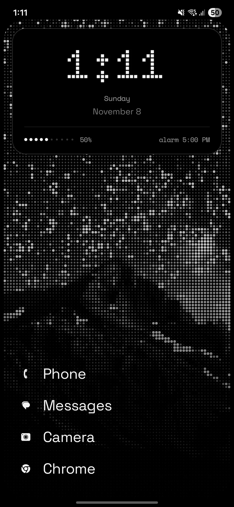
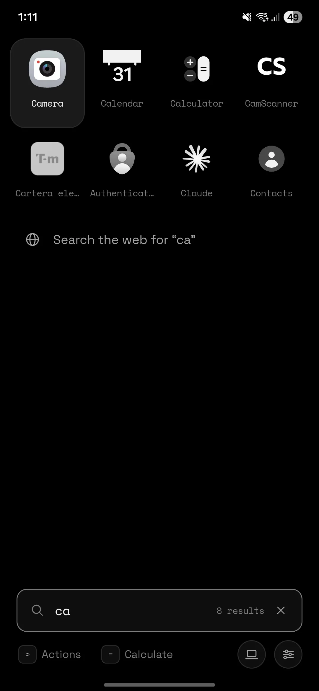
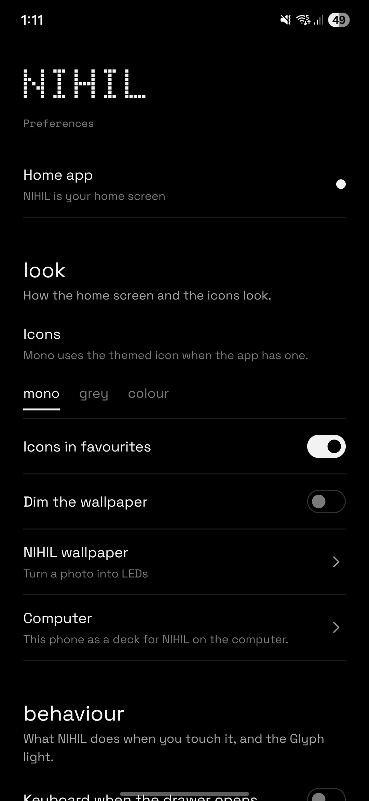
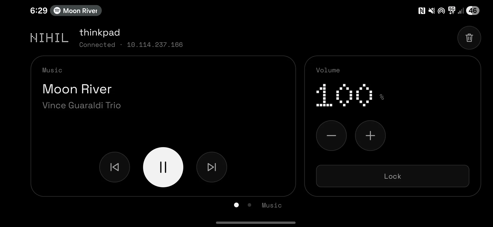
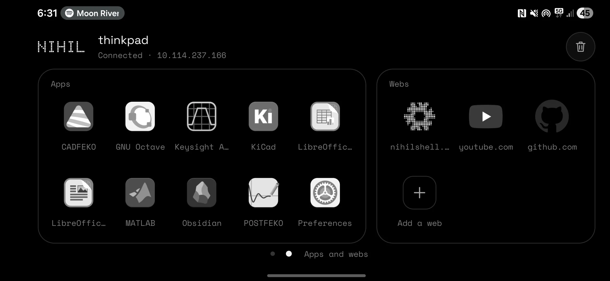

  <picture>
    <source media="(prefers-color-scheme: dark)" srcset="docs/brand/nihil-logo-dark.svg">
    
  </picture>

<i>ex nihilo</i>

A monochrome, dot-matrix launcher for Android

  <a href="https://nihilshell.com/android/">Website</a> &nbsp;&nbsp;&nbsp;
  <a href="#install">Install</a> &nbsp;&nbsp;&nbsp;
  <a href="docs/privacy.md">Permissions</a> &nbsp;&nbsp;&nbsp;
  <a href="https://github.com/poligle/Nihil-Shell">Desktop for NixOS</a> &nbsp;&nbsp;&nbsp;
  <a href="https://github.com/poligle/Nihil-Wear">Watch for Wear OS</a>

  &nbsp;
  &nbsp;
  

NIHIL for Android is my home screen. It speaks the language of
[NIHIL](https://github.com/poligle/Nihil-Shell), my NixOS desktop: black, greys for
hierarchy, dots for display, red only to interrupt, and light that runs along the edge.
I wrote it because every launcher worth using either costs money or is full of ads.

No ads, no tracking, no account. It talks to nothing but **your own computer**, and only
if you pair it as a deck: that is all its `INTERNET` permission is for. It is about 11,000
lines of Kotlin on the Android framework alone — no AndroidX, no Compose, no libraries
beyond the Kotlin standard library; even the QR reader is its own.

  &nbsp;
  

## What's in it

- **The frame**, as the desktop's: the wallpaper is a card set into it, and the drawer is
  the frame growing.
- **The desktop's clock** in dots, with the battery as ten LEDs.
- **The Glyph light** round the frame for every notification, twice and in red for a call
  or an alarm.
- **One field** for apps, webs, actions and sums, with a calculator near the desktop's qalc.
- **The deck**: the computer's apps, music, volume, lock and trackpad, its kanban in sync,
  and Vector to carry a file either way.
- **Webs, as apps**, and a **wallpaper studio** that turns a photo into LEDs.
- **Smoked glass** if you choose it, and Spanish or English.

## Install

Any phone with Android 12 or newer should work.

1. Download `nihil-launcher-v….apk` from the
   [latest release](https://github.com/poligle/Nihil-Launcher/releases/latest).
2. Open it on the phone and let your browser or file manager install apps when Android
   asks.
3. Open **NIHIL** from the app list and tap **Home app**.

What the light on the frame and the double tap need, and how to build it, is in
[Install and build](docs/install.md).

## Learn more

- [Everything in it](docs/features.md)
- [Gestures, search and settings](docs/reference.md)
- [The deck](docs/deck.md)
- [Permissions](docs/privacy.md)
- [Install and build](docs/install.md)
- [Design](docs/design.md)
- [Inside NIHIL for Android](docs/inside.md)

## Credits

- [NIHIL for NixOS](https://github.com/poligle/Nihil-Shell), where the language comes from,
  and [Caelestia](https://github.com/caelestia-dots/shell) for the frame-and-drawers idea.
- [Nothing](https://nothing.tech) for the design language that inspired the look. NIHIL is a
  personal project and is not affiliated with Nothing Technology.
- The robot of the icon and the logo: the Android robot is reproduced or modified from work created and
  shared by Google and used according to terms described in the
  [Creative Commons 3.0 Attribution License](https://creativecommons.org/licenses/by/3.0/).
  Android is a trademark of Google LLC.
- The deck's caffeine, night light and lock, and the tasks' broom: the desktop's own glyphs, from
  [Material Design Icons](https://pictogrammers.com/library/mdi/), under the
  [Pictogrammers Free License](https://github.com/Templarian/MaterialDesign/blob/master/LICENSE).
- Fonts: [Doto](https://github.com/oliverlalan/Doto),
  [Space Grotesk](https://github.com/floriankarsten/space-grotesk) and Space Mono, under the
  SIL Open Font License 1.1 ([`OFL.txt`](app/src/main/assets/fonts/OFL.txt)).

## Licence

MIT ([`LICENSE`](LICENSE)). Changes are in [CHANGELOG.md](CHANGELOG.md).
