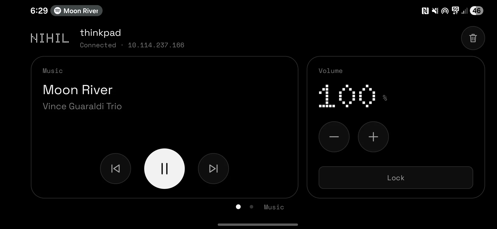
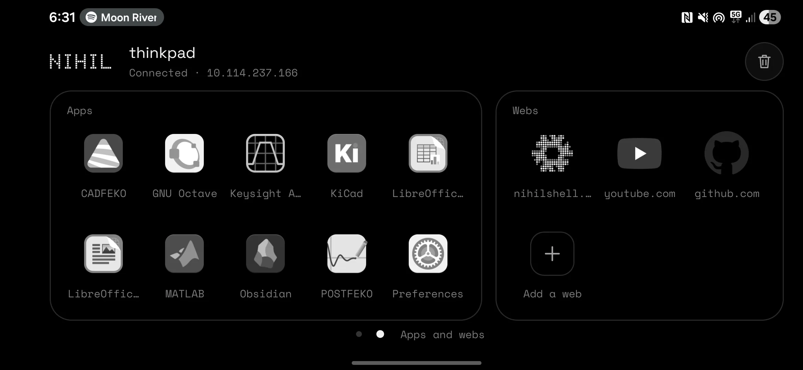
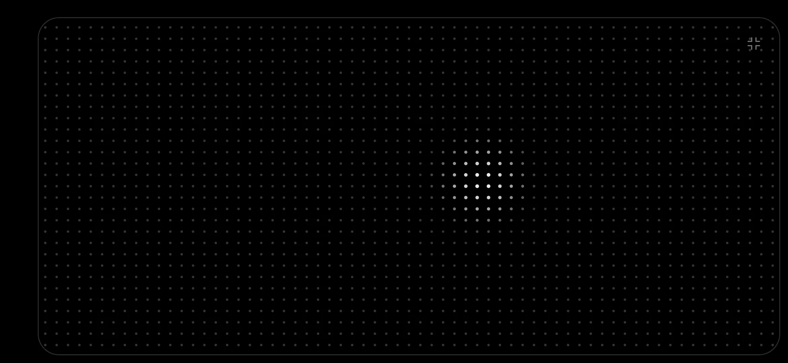
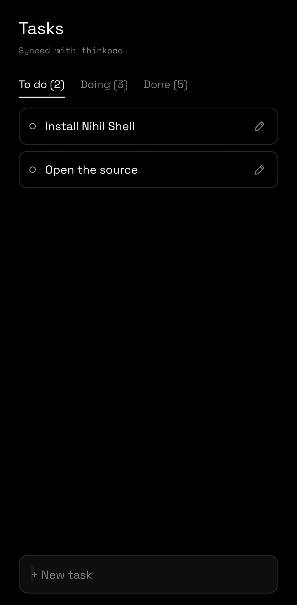

# The deck

The phone as a remote for [NIHIL](https://github.com/poligle/Nihil-Shell) on your computer:
it opens the computer's apps and webs, plays, pauses and skips its music, turns its volume,
locks it and is its trackpad, and Vector carries things between them. It can't run commands
or read the computer's files.

1. On the computer: Preferences → Devices → **Use devices**, apply, then **Pair a device**.
2. On the phone: the laptop key under the drawer's field, `> computer`, or Settings →
   Computer → **Pair**, and point the camera at the QR.

  &nbsp;
  

The deck is landscape, on one screen, in workspaces as the desktop's: the music with its
cover, in greys, and the volume with its LEDs in the first; the apps and the webs, each
scrolling on its own, in the second; the trackpad in the third. Swipe the header or tap the
dots to go from one to another; on the first two, a swipe anywhere does it too. Hold an app
or a web and move it to put them in order. In the header, the computer's caffeine, night
light and lock, with the desktop's own icons and lit while on. What plays on the computer
shows as it changes. **Screen on in the deck**, in Settings, keeps this phone's screen on
while it is open. The apps come with the computer's icons; the webs are kept on the phone
(add one, or share it from the browser), with icons the computer finds for them.
**Open on the computer** in the share sheet opens a web there.

- **Only your computer.** HTTPS that trusts one certificate, the one whose key is pinned in
  the QR, checked before anything is sent. When the computer's address changes, the phone
  finds it again with mDNS; the pin still decides.
- **Its own QR reader.** The camera's frames go to `core/QrDecoder.kt` and nowhere else.
- **A token per phone**, encrypted with a key that never leaves the Android Keystore, out of
  backups. Forget the phone in Preferences and it forgets the computer too.
- **With no network in common, Bluetooth.** When none of the computer's addresses answer, the
  phone finds it over Bluetooth LE, by a UUID made from the pin, and opens a channel to it with
  the same HTTPS on it, pinned the same. Nothing to pair in Android's settings; Android asks
  once for nearby devices. Slower than Wi-Fi: enough for the keys, the music and the trackpad,
  but a big file to Vector takes minutes. It needs NIHIL on the computer with **Without a
  network, over Bluetooth** on, in Preferences → Devices.

The protocol is [docs/deck.md](https://github.com/poligle/Nihil-Shell/blob/nihil/docs/deck.md)
in Nihil-Shell.

## The trackpad

  

The third workspace is your computer's touchpad. The fingers go as they are, every sample the
screen takes with its time, to a touchpad NIHIL makes on the computer at the size of the
phone's screen; the computer's own driver reads it as the laptop's, with its settings. A tap
clicks and two taps double-click, two fingers right-click and scroll, three middle-click, a
pinch zooms, and the desktop's gestures run: switching workspaces, closing a window, the
launcher. The dots light up under your fingers. The key in its corner takes it full screen,
the header, the dots and the system's bars out of the way; the same key, or back, brings
them again. It needs NIHIL on the computer from 10 November 2026 on; an older one says
so.

## Tasks

The desktop's kanban, on the phone: the key beside the computer's under the drawer's field,
or `> tasks`. To do, doing and done, the same cards in the same order. Tap a card to move it
to another column or delete it; hold it and move it to put its column in order; its pencil
writes it again. Done ones are struck through, as on the desktop, and its broom clears them.

Every change stays on the phone at once and goes to the computer when it answers; apart for
a while, each side goes on, and the next sync keeps what both did: for each card, the text
written last and the place chosen last, its column and where in it, and a deletion over
anything older (`core/TaskBoard.kt`, as `Tasks.qml` and `TaskMerge.js` on the desktop).

 

## Vector

Above the kanban, a box of LEDs that carries one thing at a time between this phone and the
computer: a text, a picture, a video or any file, up to 100 MB. What the computer sends waits
in it, and a notification says it came, until it is used: copied (a text or a picture), saved
in `Download/Vector`, opened, shared or let go. Then the box is empty again. A tap does the
first of these, and the notification copies and saves too. Empty, a tap picks a picture or a
file to send, its key sends what this phone copied, and **Vector** in the share sheet sends
anything shared to it; what goes shrinks out of the box, and a notification says it went. On
the computer it is the dashboard's Vector, under the clock, and what it saves goes to
`~/Vector`. While the phone is on and paired it listens, the request held open by the computer
until there is something; with the screen off it waits.
