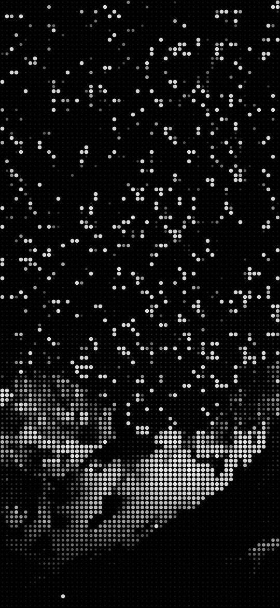

# What's in it

- **The frame.** The screen is black and the wallpaper is a rounded card set into it, the
  same frame as the desktop. The status bar and the gesture bar sit on the frame, and the
  card follows the screen's own rounded corners.
- **The drawer is the frame growing, and the desktop's launcher.** Swipe up and the card's
  bottom edge follows your finger until the whole screen is frame. The apps in a monochrome
  grid, the first result raised and in colour, the field at the bottom by your thumb.
- **The desktop's clock.** A black card with the time in dots, the day and the date; under a
  hairline, the battery as ten LEDs (red at 15 % when it isn't charging), the next alarm and
  the apps with unread notifications.
- **The Glyph light.** With notification access, the desktop's light runs once round the
  frame for every notification, twice and in red for a call or an alarm, and climbs from the
  bottom when the charger goes in. With the accessibility service, round the screen's own
  corners over any app.
- **The deck.** Paired with NIHIL on your computer, the phone opens its apps and webs, plays
  its music, turns its volume, locks it and is its trackpad, with the desktop's own gestures.
  The desktop's kanban comes along, in sync, and Vector carries a text, a picture, a video or
  any file either way. [More](deck.md).
- **Webs, as apps.** Add one from the home screen's menu or a browser's share sheet: it
  waits in the drawer among the apps, goes on the home screen like them, and opens in Chrome
  in a tab of its own. [More](reference.md#webs).
- **One field.** Apps, actions and sums in a single search, accents and case ignored;
  `>` for actions, `=` for a calculator near the desktop's qalc: units, bases, percentages,
  derivatives, integrals and equations.
- **Wallpaper studio.** A photo becomes an LED matrix at the exact resolution of the
  screen, with the desktop's algorithm; a fresh install starts with NIHIL's night.
- **Icons in one voice.** Themed icons in ink; apps without one get their foreground layer
  in greys. Or grey, or the original colours. NIHIL's own is the Android robot in dots, as
  the desktop wears the NixOS snowflake.
- **Spanish or English**, the phone's language or its own (Android 13 and later).
- **Smoked glass**, off unless chosen: the frame and every surface as dark glass, as on the
  desktop. The wallpaper NIHIL put on shows through frosted, clear and bent near the edges,
  bright dots glowing through it and lighting the edges near them (Android 13 and later);
  any other wallpaper shows through the smoke without the bend.

## Wallpaper studio

Hold the home screen → **NIHIL wallpaper**, or type `> wallpaper`.

Pick a photo and it becomes an LED matrix at the exact resolution of the screen (on a
tablet, a square as long as its longest side, so it shows dot for dot either way up), with
the same algorithm and constants as the desktop's
[`theme/dotmatrix.py`](https://github.com/poligle/Nihil-Shell/blob/nihil/theme/dotmatrix.py):
the light of each cell, the black point raised so a night sky stays off, single
highlights lit as stars, and LEDs that grow with their brightness.

Fine, normal or coarse dots; the home screen, the lock screen or both. It all happens on
the phone: the photo goes nowhere.

Right: the desktop's <code>night.jpg</code> through the studio's algorithm, normal dots.

 
