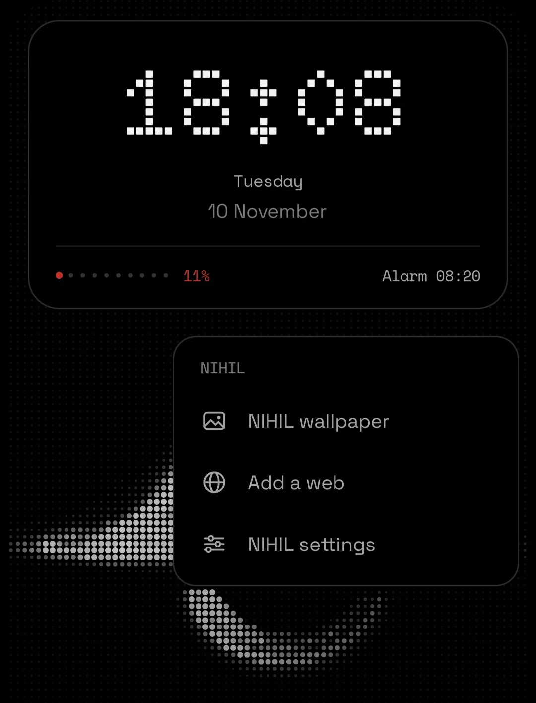

# Gestures, search and settings

## Gestures

| On the home screen | Does                                                       |
|--------------------|------------------------------------------------------------|
| Swipe up           | The drawer, following your finger                          |
| Swipe down         | The notification shade                                     |
| Double tap         | Locks the phone (optional)                                 |
| Hold empty space   | NIHIL wallpaper, Add a web, NIHIL settings                 |
| Hold an app        | Its shortcuts, add to home, move, hide, app info, uninstall; on the home screen, move it to put the favourites in order |
| Hold a web         | Add to home, move, edit it with the pencil, remove         |
| Home button        | Closes the drawer or a menu                                |

In the drawer, a downward drag closes it when the list is at the top; back does the same.

## The drawer

| Type           | Gets                                                                 |
|----------------|----------------------------------------------------------------------|
| *(empty)*      | Every app and web, alphabetically, in a grid                         |
| `camara`       | *Cámara*: accents and case don't matter                              |
| `yout`         | A web kept on the phone, by its name or by its address               |
| `settings`     | *Ajustes*, through its package name (`com.android.settings`)         |
| `lin`          | Apps and actions together: here, the torch                           |
| `12*7`         | A sum is recognised on its own; enter copies the result              |
| `10 km to mi`  | So is a conversion, of units or into hex, bin and oct                |
| `> `           | The actions: torch, Wi-Fi and sound panels, Bluetooth, battery, alarms, lock, studio, settings |
| `= `           | The calculator, [below](#the-calculator)                             |
| No match       | *Search the web for…*, in your own browser                           |

Hidden apps leave the list but search still finds them, marked *hidden*.

### The calculator

As near the desktop's (qalc) as one Kotlin file gets, comma or point for decimals:

| Type                         | Gets                                                   |
|------------------------------|--------------------------------------------------------|
| `2(3+4)^2`, `5!`, `2pi`      | The usual, with implicit products                      |
| `200 + 15%`, `200 * 15%`     | 230 and 30: percentages as qalc reads them; `mod` for the remainder |
| `sin(30°)`, `atan(1)`        | Degrees with `°`, radians otherwise                    |
| `max(3; 4)`, `gcd(12; 18)`   | Several arguments, apart with `;` or `, `              |
| `10 km to mi`, `100 °F a °C` | Length, mass, time, temperature, data, speed, volume, area, energy, pressure, power, angle |
| `0xff`, `255 to hex`         | Hex, binary and octal, both ways                       |
| `diff(x^2)`, `diff(x^3; 2)`  | 2x, and its value at 2: 12                             |
| `integrate(x^2)`, `integrate(x^2; 0; 3)` | x^3/3 + C, and 9; bounds may be `inf`      |
| `solve(x^2 = 4)`             | x = -2, x = 2 (real solutions)                        |
| `sum(i^2; i; 1; 10)`, `limit(sin(x)/x; x; 0)` | 385 and 1; `product` too          |

Spanish names work too: `deriva`, `integra`, `resuelve`, `suma`, `producto`, `límite`. No
currencies: they would need the internet.

### Webs

Hold the home screen → **Add a web**, or share a page from a browser to **Add to NIHIL**:
its address and, if you like, a name. A web waits in the drawer among the apps, by its name,
and search finds it by its name or by its address. Hold it to put it on the home screen, to
write it again with the pencil or to remove it.

It opens in Chrome, or in the phone's browser without it, each web in a tab of its own that
opening it again goes back to. Its icon comes from your computer when the phone is paired
as a deck, as the deck's webs' do, so the phone still talks to no one else; without one, it
has its letter.

 

## Settings

Open **NIHIL** from the app list, the gear in the drawer, or hold the home screen.

| Setting                         | Default | What it does                                                      |
|---------------------------------|---------|-------------------------------------------------------------------|
| Home app                        |         | Makes NIHIL the home screen                                       |
| Icons                           | Mono    | `mono` themed icons in ink, `grey`, or `colour`                   |
| Icons in favourites             | On      | Icons next to the favourites, or names alone                      |
| Dim the wallpaper               | Off     | A dark veil over any wallpaper                                    |
| NIHIL wallpaper                 |         | The studio                                                        |
| Keyboard when the drawer opens  | On      | Type straight away, or browse first                               |
| Language                        |         | Android 13 and later: English or Spanish, whatever the phone speaks |
| Computer                        |         | The deck: pair with NIHIL on your computer                        |
| Screen on in the deck           | Off     | This phone's screen doesn't turn off while the deck is open       |
| Glyph light                     | On      | The light on the frame and the unread icons (needs notification access); over other apps too with Accessibility |
| Accessibility                   | Off     | The double tap to lock, and the Glyph light over other apps: NIHIL's accessibility service, which reads nothing |
| Hidden apps                     |         | Show them in the list again                                       |
